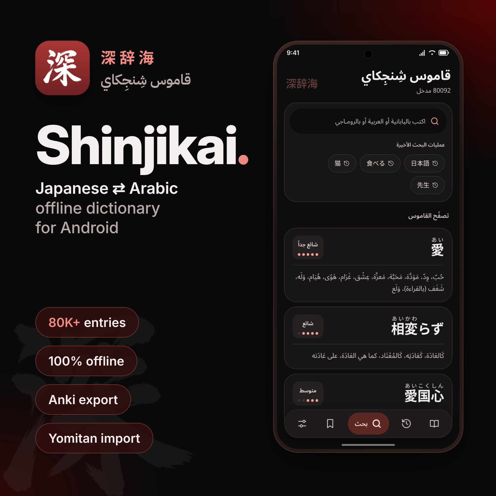

<p align="center">
  
</p>

<h1 align="center">قاموس شِنجِكاي · 深辞海</h1>

<p align="center"><a href="./README.md">English</a> · <b>العربية</b></p>

<div dir="rtl">

<p align="center">قاموس ياباني ⇄ عربي لأندرويد يعمل بالكامل دون اتصال بالإنترنت، مبني بلغة Kotlin وJetpack Compose.</p>

<p align="center">
  <a href="https://play.google.com/store/apps/details?id=com.shinjikai.dictionary"></a>
</p>

<p align="center">
  
  
  
</p>

---

## الميزات

- **ابحث بأي كتابة:** باليابانية (كانجي أو كانا) أو بالعربية أو بالروماجي. يُرجع التطبيق الأفعال والصفات المصرّفة إلى صيغتها القاموسية تلقائيًا.
- **أكثر من 80 ألف مدخل دون إنترنت:** القاموس كاملًا مدمج في التطبيق ومفهرس على الجهاز باستخدام SQLite FTS.
- **صفحة غنية لكل كلمة:** فيها الفوريغانا، ومستوى JLPT، ودرجة الشيوع، والتصنيفات، والمعاني العربية، والشرح الياباني، والكلمات ذات الصلة، والنطق الصوتي.
- **تصفّح القاموس** حسب التصنيف، أو استعرض كلمات عشوائية.
- **المحفوظات وسجل البحث:** احفظ الكلمات، وارجع إلى عمليات البحث السابقة، وصدّر محفوظاتك إلى ملف CSV.
- **التصدير إلى أنكي:** أرسل أي كلمة إلى AnkiDroid كبطاقة مراجعة بلمسة واحدة.
- **استيراد قواميس Yomitan:** أضف أرشيفات قواميسك الخاصة إلى جانب البيانات المدمجة.
- **واجهة Material 3** مصممة للعربية أولًا (من اليمين إلى اليسار)، مع المظهر الفاتح والداكن والألوان الديناميكية.

## البناء والتشغيل

المتطلبات: أحدث إصدار مستقر من Android Studio، وJDK 17.

```bash
git clone https://github.com/objx0/Shinjikai-Android.git
```

1. افتح المشروع في Android Studio وانتظر حتى يكتمل Gradle Sync.
2. شغّل إعداد `app` على جهاز أو محاكي بنظام Android 7.0 (API 24) أو أحدث.

خدمات Firebase (Analytics وCrashlytics) اختيارية، ولا تُفعَّل إلا عند وجود الملف `app/google-services.json`. يعمل البناء بشكل طبيعي من دونه.

## القاموس المدمج

يأتي التطبيق مزوّدًا ببيانات [`1Selxo/Shinjikai`](https://github.com/1Selxo/Shinjikai). لتحديثها شغّل:

```powershell
.\scripts\fetch-bundled-dictionary.ps1
```

ينزّل السكربت البيانات إلى `app/src/main/assets/bundled_dictionary/`، ويضغط ملفات `data_*.jsonl` بصيغة `.jsonl.xz`، ويحزم الصور في أرشيفات `tar.xz` مجزأة ومتوافقة مع Git. عند التشغيل الأول، يستورد التطبيق البيانات إلى Room/FTS ويستخرج الصور إلى مساحة تخزينه، ثم تعمل كل عمليات البحث محليًا.

## هيكل المشروع

| المسار | المحتوى |
| --- | --- |
| `app/src/main/java/com/shinjikai/dictionary/` | واجهة Compose والتنقل والشاشات |
| `…/data/` | النماذج وقاعدة بيانات Room والمستودعات وأدوات الاستيراد والبحث |
| `…/integration/` | التصدير إلى أنكي وإلى CSV |
| `app/src/main/res/` | النصوص والأيقونات والخطوط |
| `scripts/` | أدوات تجهيز القاموس المدمج |

## التقنيات المستخدمة

Kotlin · Jetpack Compose (Material 3) · Room مع FTS · Paging 3 · DataStore · Coroutines · Coil · Baseline Profiles

## الشكر والمصادر

- بيانات القاموس: [موقع شِنجِكاي](http://shinjikai.app)
- البيانات المدمجة: [1Selxo/Shinjikai](https://github.com/1Selxo/Shinjikai)
- قواعد إرجاع التصريفات اليابانية: [Yomitan](https://github.com/yomidevs/yomitan/tree/master/ext/js/language/ja) (بترخيص GPL-3.0-or-later)

<blockquote dir="rtl" align="right"><p dir="rtl" align="right"><b>تطبيق غير رسمي.</b> محتوى القاموس مأخوذ من <a href="http://shinjikai.app">موقع شِنجِكاي</a> وحقوقه محفوظة لأصحابه. هذا التطبيق مشروع مستقل لا يتبعهم ولا يحظى باعتماد رسمي منهم.</p></blockquote>

## الترخيص

الشيفرة المصدرية للتطبيق منشورة بموجب [ترخيص MIT](./LICENSE). أما بيانات القاموس فلا يشملها هذا الترخيص، وتخضع لشروط مصدرها الأصلي.

</div>
