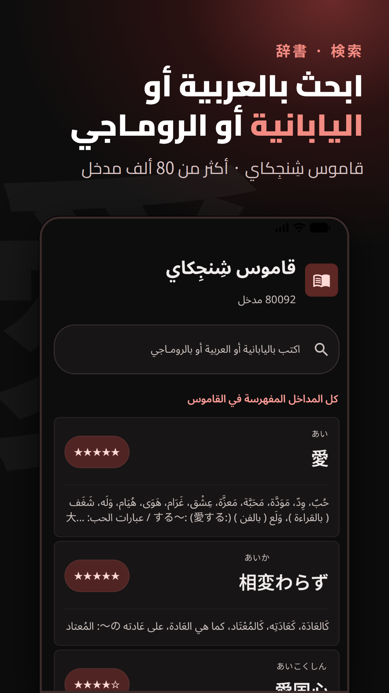
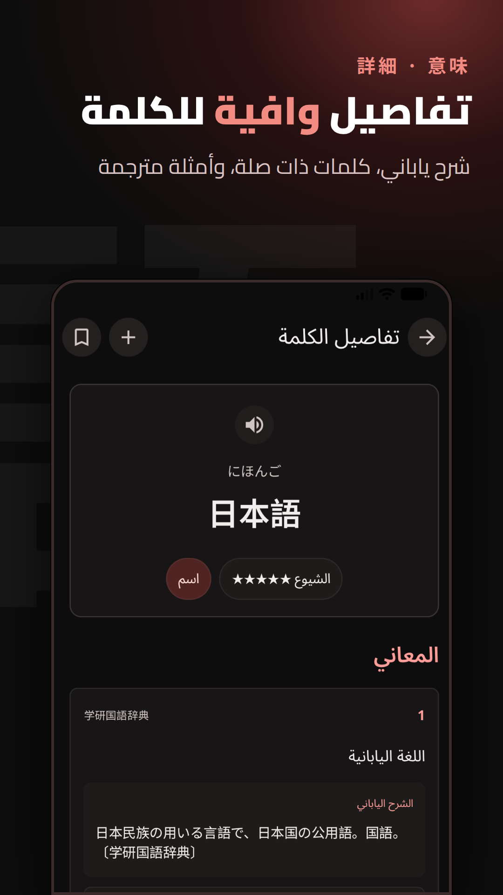

<h1 align="center">قاموس شنجكاي للأندرويد</h1>

<p align="center"><a href="./README.md">English</a> | العربية</p>

<div dir="rtl" align="right">

<p align="center">قاموس للكلمات اليابانية ومعانيها بالعربية، يعمل دون الاتصال بالإنترنت.</p>

<p align="center">
  <a href="https://play.google.com/store/apps/details?id=com.shinjikai.dictionary"></a>
  <a href="#" aria-label="F-Droid coming soon"></a>
</p>

## 📱 لقطات الشاشة

<table align="center">
  <tr>
    <td align="center"></td>
    <td align="center"></td>
  </tr>
</table>

> ⚠️ **إخلاء المسؤولية**
>
> هذا مشروع مستقل. مصدر بيانات القاموس هو [موقع شنجكاي](http://shinjikai.app).

## ✨ الميزات

- 🔎 بحث سريع عن الكلمات باليابانية والعربية
- 🧾 تفاصيل شاملة للكلمات تشمل الكانا والكانجي ومستوى JLPT والتصنيفات والمعاني العربية والكلمات ذات الصلة
- 🔖 العلامات المرجعية لحفظ الكلمات وإدارتها
- 🕘 عمليات البحث الأخيرة
- 📦 بحث يعمل بالكامل دون اتصال بالإنترنت، مع بيانات مدمجة ودعم لاستيراد قواميس Yomitan محليًا
- 🃏 تصدير الكلمات وتعريفاتها من التطبيق إلى Anki
- 🎨 واجهة Material 3 مع دعم المظهر الفاتح والداكن

## 🛠️ التقنيات المستخدمة

- Kotlin
- Jetpack Compose (Material 3)
- Gson
- Room مع فهرسة نصية كاملة (FTS) للقاموس المحلي والعلامات المرجعية
- Coroutines

## ▶️ تشغيل التطبيق

1. افتح هذا المجلد في Android Studio.
2. انتظر حتى يكتمل Gradle Sync.
3. شغّل إعداد `app` على محاكي أو جهاز أندرويد.

## ⚙️ ملاحظات

- يعمل البحث محليًا باستخدام فهارس Room FTS الخاصة بالقاموس المدمج أو المستورد.
- تعتمد بعض الحقول مثل الروابط ذات الصلة والتصنيفات على البيانات المتوفرة لكل كلمة.
- إذا لم تتوفر البيانات المدمجة، يمكن استيراد أرشيف قاموس مدعوم من إعدادات القاموس المحلي.

## 🗂️ هيكل المشروع

- `app/src/main/java/com/shinjikai/dictionary/` -> الواجهة وتدفق التطبيق
- `app/src/main/java/com/shinjikai/dictionary/data/` -> نماذج القاموس والمستودعات وأدوات الاستيراد وRoom والبحث المحلي
- `app/src/main/res/` -> الموارد، مثل النصوص والسمات والأيقونات والخطوط

## 📦 الأصول المعجمية المدمجة

يأتي التطبيق مزوّدًا بقاموس `1Selxo/Shinjikai` محليًا. لتحديث ملفات القاموس المدمجة، شغّل:

```powershell
.\scripts\fetch-bundled-dictionary.ps1
```

ينزّل السكربت قاموس `1Selxo/Shinjikai` ويضع البيانات في `app/src/main/assets/bundled_dictionary/`، ثم يضغط ملفات `data_*.jsonl` بصيغة `.jsonl.xz` ويعيد ضغط الصور عندما يكون ذلك ممكنًا، ويخزّنها في ملفات `tar.xz` مجزأة ومتوافقة مع Git. عند التشغيل الأول، يستورد التطبيق ملفات JSONL المدمجة إلى Room/FTS ويستخرج الصور إلى مساحة تخزين التطبيق، ثم تعمل جميع عمليات البحث محليًا باستخدام فهارس SQLite.

## ❤️ المساهمون والحقوق

- المصدر الأساسي لبيانات القاموس: **[موقع شنجكاي](http://shinjikai.app)**
- مجموعة بيانات القاموس المدمجة: **1Selxo/Shinjikai** (`https://github.com/1Selxo/Shinjikai`)
- قواعد فكّ تصريف الكلمات اليابانية: **Yomitan** (`https://github.com/yomidevs/yomitan/tree/master/ext/js/language/ja`)، بترخيص GPL-3.0-or-later.

</div>
