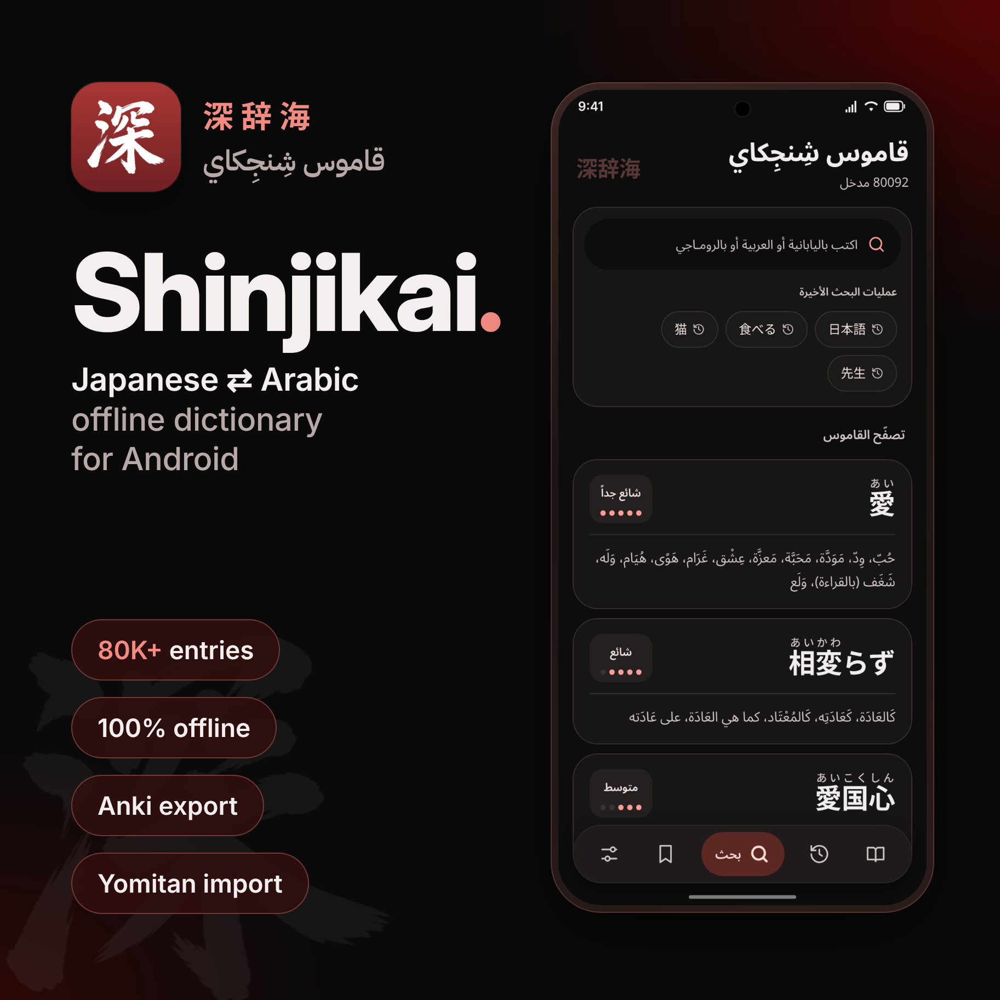

<p align="center">
  
</p>

<h1 align="center">Shinjikai · 深辞海</h1>

<p align="center"><b>English</b> · <a href="./README.ar.md">العربية</a></p>

<p align="center">An offline Japanese ⇄ Arabic dictionary for Android, built with Kotlin and Jetpack Compose.</p>

<p align="center">
  <a href="https://play.google.com/store/apps/details?id=com.shinjikai.dictionary"></a>
</p>

<p align="center">
  
  
  
</p>

---

## Features

- **Search in any script.** Type Japanese (kanji or kana), Arabic, or romaji. Conjugated verbs and adjectives are reduced to their dictionary form.
- **80,000+ entries, fully offline.** The whole dictionary ships with the app and is indexed on-device with SQLite FTS, so you don't need a connection.
- **Rich word pages.** Each page shows furigana, JLPT level, a commonness level, categories, Arabic meanings, Japanese definitions, related words, and audio pronunciation.
- **Browse the dictionary** by category, or shuffle through random entries.
- **Bookmarks and history.** Save words, revisit past searches, and export your bookmarks to CSV.
- **Anki export.** Send any word straight to AnkiDroid as a flashcard.
- **Yomitan import.** Add your own Yomitan dictionary archives alongside the built-in data.
- **Material 3 UI** with an Arabic-first RTL layout, light and dark themes, and dynamic color.

## Build

Requirements: Android Studio (latest stable) and JDK 17.

```bash
git clone https://github.com/objx0/Shinjikai-Android.git
```

1. Open the project in Android Studio and let Gradle sync.
2. Run the `app` configuration on a device or emulator (Android 7.0 / API 24 or newer).

Firebase (Analytics and Crashlytics) is optional. It is only enabled when `app/google-services.json` is present, and builds work fine without it.

## Bundled dictionary

The app ships with the [`1Selxo/Shinjikai`](https://github.com/1Selxo/Shinjikai) dataset. To refresh it:

```powershell
.\scripts\fetch-bundled-dictionary.ps1
```

The script downloads the dataset into `app/src/main/assets/bundled_dictionary/`. It compresses the `data_*.jsonl` files to `.jsonl.xz` and packs the images into git-safe, chunked `tar.xz` archives. On first launch, the app imports the data into Room/FTS and extracts the images to app storage. After that, every lookup runs locally.

## Project structure

| Path | Contents |
| --- | --- |
| `app/src/main/java/com/shinjikai/dictionary/` | Compose UI, navigation, and screens |
| `…/data/` | Models, Room database, repositories, importers, and search |
| `…/integration/` | Anki and CSV exporters |
| `app/src/main/res/` | Strings, icons, and fonts |
| `scripts/` | Bundled-dictionary tooling |

## Tech stack

Kotlin · Jetpack Compose (Material 3) · Room with FTS · Paging 3 · DataStore · Coroutines · Coil · Baseline Profiles

## Credits

- Dictionary data: [Shinjikai](http://shinjikai.app)
- Bundled dataset: [1Selxo/Shinjikai](https://github.com/1Selxo/Shinjikai)
- Japanese deinflection rules: [Yomitan](https://github.com/yomidevs/yomitan/tree/master/ext/js/language/ja) (GPL-3.0-or-later)

> **Unofficial app.** The dictionary content comes from [shinjikai.app](http://shinjikai.app) and belongs to its authors. This app is an independent project and is not affiliated with or endorsed by them.

## License

The app's source code is released under the [MIT License](./LICENSE). The dictionary data is not covered by this license and stays subject to the terms set by its original source.
